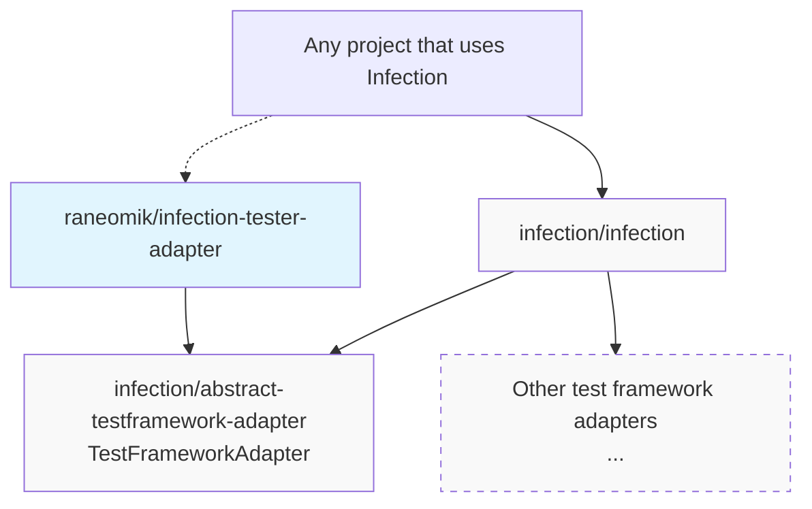

# Tester Test Framework Adapter for Infection

[](https://github.com/raneomik/infection-tester-adapter/actions/workflows/cs.yaml)
[](https://github.com/raneomik/infection-tester-adapter/actions/workflows/mutation-testing.yaml)
[](https://github.com/raneomik/infection-tester-adapter/actions/workflows/tests.yaml)
[](https://coveralls.io/github/raneomik/infection-tester-adapter?branch=main)
[](https://dashboard.stryker-mutator.io/reports/github.com/raneomik/infection-tester-adapter/main)
<details>

<summary> 
Disclaimer: AI agent experiment 
</summary>

> _chat-gpt5.2 & claude sonnet 4.5 & later 5.5 wrote ~60-75% of this project, by my lack of knowledge on this topic and lack of time to learn..._
> _I thought it would be interesting to ask AI "Hey, I discovered [this framework][nette], and it comes with its [own testing framework][tester]. But I love Infection and its metrics to push you to test your tests, and could be cool to add an adapter to it... Are we in ? - yes, Here's your code"_
> _(it wasn't this simple, [here's some copilot's very verbose journals & reports](https://github.com/raneomik/infection-tester-adapter/tree/42b7946/docs/copilot-report) for french speakers - it's a real mess, sorry, all dev problems seem to be included)_
> _and share the result._
>
> _The remaining ~20% was based on [PhpSpec Adapter][phpspec-adapter] and [Codeception Adapter][codeception-adapter]. Big shoutout to Maks Rafalko & Infection community for this amazing tool_
</details>

This package provides the [Tester][tester] test framework adapter for [Infection][infection].



## Requirements

- PHP 8.3+
- [nette/tester][tester] 2.5+
- PCOV or Xdebug (PCOV is used when both are loaded)

## Installation

```shell
composer require --dev raneomik/infection-tester-adapter
```

The adapter is registered automatically through [infection/extension-installer][infection/extension-installer] (allow the plugin when Composer asks).

## Usage

Once installed, you can run Infection:

```shell
vendor/bin/infection # optional: --test-framework=tester
```

### Configuration

This adapter works directly with your existing Tester tests, with some limitations:

- Tester provides jUnit.xml and Clover.xml coverage reports, but Infection expects a more complete phpunit-like report. This adapter embeds transformation of Tester's reports & generation during the mutation process, so it is NOT recommended to use `--skip-initial-tests` with `--coverage` options (it just results in xpath read/FQCN error, unless you are using a script which does the needed transformation).
- [Test cases](https://tester.nette.org/en/testcase) are recommended for a better report result. But seem slower.
- other forms of tests are supported, but need namespaces to be identified by Infection and referenced in report as covering code.
- test files must be named `*Test.php` (or `*test.php`): `.phpt` files run, but don't count as covering code.
- Tester runs PHP without php.ini (`-n`) by default: pass `-C`, `-c <php.ini>`, `-d <key=value>` or `-p <php>` in `--test-framework-options`, they are kept for mutant runs too (test paths are not, mutants only run their covering tests).
- conflict with files may occur using `--debug` option and result in mutation coverage generation errors. Removing '<configured tmp dir|/tmp>/infection' should fix it.

No additional configuration needed, "Convention over configuration" principle: the only requirement is a `tests/bootstrap.php` file at your project root.

A minimal `infection.json5`:

```json5
{
    "source": {
        "directories": ["src"]
    },
    "testFramework": "tester"
}
```

For more information on configuring Infection, see the [Infection documentation][infection-configuration-docs].

## Contributing

Contributions are welcome! Open an issue or a pull request; `make all` runs the CS fixes, static analysis, unit, mutation and e2e tests (`make help` lists the targets).

## License

This project is licensed under the BSD 3-Clause License. See the [LICENSE](LICENSE) file for details.

[infection]: https://infection.github.io
[infection-configuration-docs]: https://infection.github.io/guide/usage.html#Configuration
[infection/extension-installer]: https://packagist.org/packages/infection/extension-installer
[nette]: https://nette.org
[tester]: https://tester.nette.org/en
[phpspec-adapter]: https://github.com/infection/phpspec-adapter
[codeception-adapter]: https://github.com/infection/codeception-adapter

